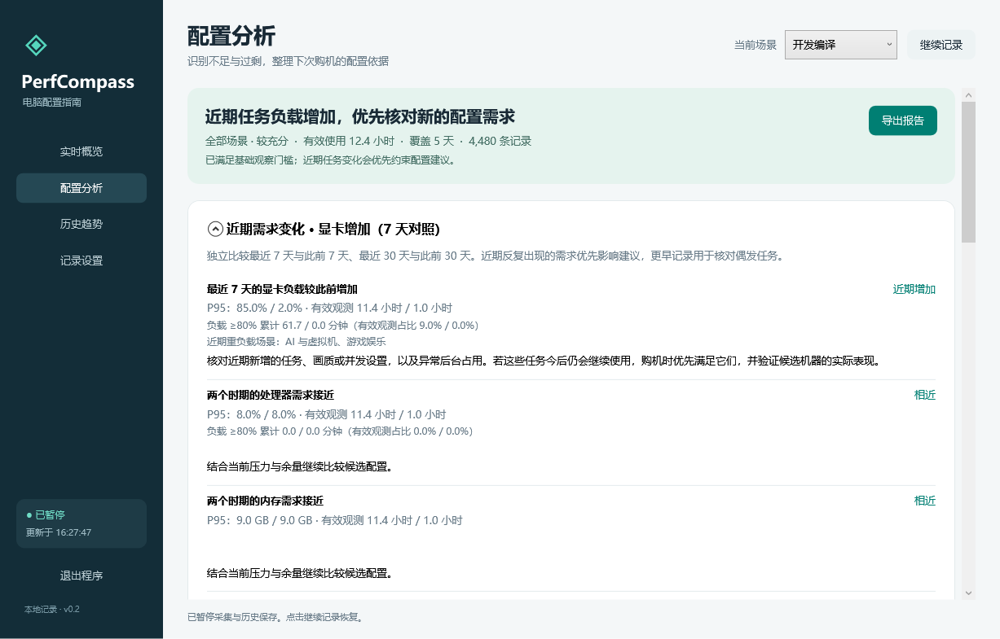

# PerfCompass

Windows 原生电脑占用监测与购机配置分析工具。C# / .NET 10 / WPF；采样与历史保存在本机，可选模型解析会在主动点击时向所配服务发送需求描述。

双击根目录 `启动.cmd`。通过验证的新版本位于 `release-next/`，启动器优先使用它，并继续读取 `release/data/` 中的历史。已经运行的旧版本需要正常退出后再启动。发布版自带运行时，不依赖 Python 或预装 .NET。

GitHub 上的源码不包含 EXE。可从 [Windows 构建流程](https://github.com/Southwall-Tester/PerfCompass/actions/workflows/windows.yml) 中成功的运行下载 `PerfCompass-Windows-x64` 产物，解压后运行 `PerfCompass.exe`。当前为开发试用版，尚未完成商业级验证。



上图使用隔离的合成测试轨迹，演示显卡过去低负载、最近一周新增重任务时的分析结果，不代表截图所在电脑的真实购机结论。

## 使用

1. 正常使用电脑，按实际任务切换右上角场景。
2. 在“配置分析”查看处理器、内存、显卡和存储的压力与余量。
3. 累计有效使用至少 10 小时、覆盖 3 天，完成常用任务后，在设置中确认记录具有代表性。
4. 导出 HTML 报告或 CSV 原始记录，供下次选机时比较。

在实时页展开“记录体验”，可保存卡顿或等待描述及此前两分钟采样线索；历史页可查看并标为已处理。未处理的近期体验问题会约束降档建议。暂停期间不关联旧采样；同时出现高占用不能证明部件是原因。

设置页的需求描述支持有限的规则预解析：列出任务、否定与未来线索，AI 描述还需核对本地或云端方式。用户确认保存后，字段才参与建议；修改原文会取消旧确认。当前规则不支持通用自然语言，可能遗漏条件、时间与数值关系。未识别片段保留原文，不悄悄转成硬件要求。论文、开源方案和 36 条广度诊断见 [NLP_RESEARCH.md](docs/NLP_RESEARCH.md)。

0.4.0 另提供可选的“模型解析与逐项核对”：配置兼容的结构化聊天接口后，可提取开放的任务名称、资源目标、预算、便携等事项，并分别保留否定、条件与时间。候选默认不选用，可修改、排除或补充，确认保存后才影响建议。接口仅发送需求文字，不附带监测记录；密钥仅在当前运行保留。本机接口会暂停监测，需要先停止本地模型服务再继续。尚未默认采用任何模型，详见 [模型解析说明](docs/MODEL_REQUIREMENTS.md)。

0.5.0 新增“候选配置”：比较两三套电脑的报价、容量与实际任务结果，导入已确认需求、已有场景和近期变化，分别保留必需与条件需求。输出不足项、待验证项、通过条件的报价差及容量/任务变化；没有证据时不猜测新机器性能。比较可保存并导出报告，详见 [候选比较说明](docs/CANDIDATE_COMPARISON.md)。

候选、条件和任务结果保存在同一数据目录的 `comparison.json`，不随采样保留期自动清理；损坏文件保留原件并禁止覆盖。报价与测量目前由用户提供，尚未独立核实。

0.8.8 核对日历时间与独立经过时间：校时或长采样间隔产生零时长中断记录，重建基线后继续采集；中断不算成有效使用或空闲负载。实时页显示提示，历史、报告及 CSV 保留原因。自动分析、清理和进程列表改用经过时间调度，避免回拨时钟后长时间不刷新。详见 [计时与中断](docs/DEMAND_MODEL.md#计时与中断)。

0.8.7 对完全相同的历史记录按一次计算；不同记录的有效时间片重叠时，按唯一时段计时，负载、压力与余量暂待核对，原文件保留。同一数据目录增加文件共享锁，防止新版程序经大小写或路径别名重复启动。详见 [历史完整性](docs/DEMAND_MODEL.md#历史完整性) 与 [目录占用](docs/DATA_PROTECTION.md#目录占用)。

0.8.6 增加历史完整性检查：损坏、截断、重复字段、缺失关键字段或无法读取的记录会显示文件和行号，保留可用观测，暂停余量及时期变化判断。读取固定已提交长度，避免随后追加的数据混入本次分析；慢采集提前合并，避免超过有效时长上限。历史异常改变时，候选比较需重新核对覆盖范围。详见 [历史完整性](docs/DEMAND_MODEL.md#历史完整性)。

0.8.5 修复硬件传感器更新失败时可能沿用缓存旧值的问题。本次更新失败的设备读数留空，实时页提示自动重试；CPU 与内存基础采集继续，失败读数不增加 GPU 有效覆盖时长，成功后恢复显示。详见 [采样边界](docs/DEMAND_MODEL.md#采样边界)。

0.8.4 完善设置保存失败与重试：需求和逐项核对输入会保留，错误提示持续显示；场景保存失败时回到实际记录的场景。后台设置先核对自启动状态，再保存偏好；保存失败时尝试恢复原自启动项，无法确认时提示检查 Windows 启动应用。详见 [数据保护](docs/DATA_PROTECTION.md)。

0.8.3 将典型任务覆盖确认绑定到当前硬件配置。升级硬件、复制不同配置的记录，或从未绑定确认的旧版升级后，需要在设置中重新确认；原始历史保留。界面与报告显示确认状态，高负载压力线索仍可独立呈现。详见 [分析方法](docs/DEMAND_MODEL.md)。

0.8.2 在比较前检查预算、内存、显存和存储上下界是否冲突，显示涉及的条件与数值。必需条件冲突时先核对输入；条件情景分别检查，不把不同触发情景混在一起。详见 [候选比较说明](docs/CANDIDATE_COMPARISON.md)。

0.8.1 补足真实模型输出中的数值前缀与助词转换，并公开 36 条真实 4B 输出及逐例开发审阅。模型仍有明显错误，不作为默认解析器；详见 [语义审阅](docs/SEMANTIC_EVALUATION.md)。

0.8.0 新增量化目标：已核对的预算范围、严格上下限、任务耗时、帧率、重量、续航与功耗等可转换成候选比较目标，保留引用、单位和触发条件；模型改错数字或边界时继续人工核对。历史占用显示单位已更正为 GiB/MiB，新 CSV 表头同时更正，原始数值保持不变。详见 [量化目标说明](docs/QUANTITY_GOALS.md)。

0.7.0 新增数据保护：在“记录设置 → 备份与恢复”保存完整数据备份，逐文件校验后恢复到新目录；恢复后暂停监测和历史自动清理。设置损坏时先保留原件，再读取上次有效副本，等待核对。备份未加密，详见 [备份与恢复](docs/DATA_PROTECTION.md)。

0.6.0 新增“任务测量”：选定能自行退出的程序和任务输入后，重复记录运行耗时，保留每轮结果、机器、电源及协议依据，再导入对应候选的时间目标。全部正式轮次跨过目标线时保留待验证。测量期间暂停本实例的长期记录，结束后保持暂停；结果不证明任务产物正确。记录保存在 `measurements/`，详见 [任务测量说明](docs/TASK_MEASUREMENT.md)。

默认关闭窗口会收起到系统托盘并继续采集；从程序或托盘菜单退出才停止记录。可在“记录设置”更改关闭行为，并主动启用登录 Windows 后记录。暂停时停止采集与保存。程序不默认修改开机启动，不上传遥测。

## 数据与分析

- Windows API 采集每逻辑核心 CPU、物理内存、系统提交量；LibreHardwareMonitor 采集可用 GPU 和温度数据；Windows 性能计数器采集磁盘活动。
- 实时约 2 秒刷新，应用列表约 6 秒刷新，历史约 10 秒记录。历史保存有效时段平均占用，同时保留采样中的内存、显卡和最忙核心峰值，以及 CPU、GPU、内存高负载的采样持续时间。空闲时段不用于配置过剩判断；明显后台任务仍计入有效使用。休眠与暂停间隔不当作有效时长。
- 降档判断需要代表性确认、有效时长、跨日覆盖以及传感器覆盖率；缺失值保留未知，不当作零。
- 可按场景及最近 7/14/30/90 天分析；P95 按有效采样时长加权。另行对照最近 7 天与此前 7 天、最近 30 天与此前 30 天，避免大量历史闲置掩盖近期新任务。近期负载增加会约束降档建议；近期减少不会自动抹去过去重任务。缺少基线时继续观察。
- 历史充足也需要最近 7 天至少 30 分钟、跨 2 天的有效观测才能判断当前冗余；具体指标还需近期传感器证据。完整阈值与边界见 `docs/DEMAND_MODEL.md`。
- CPU 结合总体与最忙核心负载；内存保留采样峰值、提交量并设置容量余量；GPU 低负载输出待验证候选条件；磁盘容量和性能分开讨论。
- 10 小时、3 天、P95 等为透明启发式设置，尚未完成跨机型校准；采样可能漏掉短峰。具体型号比较需要候选硬件上的实际任务测试。进程名称只实时展示，不写入历史。
- 同一数据目录中的不同硬件配置按指纹隔离。指纹来自硬件型号与容量，不包含设备序列号。

通过根目录启动器运行时，数据位置为 `release/data/`；直接运行 EXE 默认使用 EXE 旁的 `data/`，也可通过 `--data-dir` 指定。`settings.json` 保存场景、设置与已确认需求，`samples-YYYY-MM-DD.jsonl` 保存采样，`experience-YYYY-MM-DD.jsonl` 保存体验及处理状态，`errors.log` 保存错误。新设置默认保留 90 天，可选 30/60/90 天；旧设置中的 30 天不会被自动改变，已清理的历史无法恢复。报告由用户主动选择保存位置。

## 开发与验证

需要 .NET 10 SDK。项目目录 `.tools/dotnet/` 存在时构建脚本优先使用该 SDK。

```powershell
.\build.ps1 -Test -Publish -OutputDirectory release-next
```

本地完成发布包验证后才创建 `release-next/READY`，再运行 `scripts/package-portable.ps1` 生成 ZIP 与 SHA256 校验文件。打包脚本拒绝用户数据、模型及非分发文件，并验证压缩包中的 EXE 与源文件哈希一致；打包成功本身不证明功能验证通过。

分析与持久化回归结果写入 `artifacts/self-tests.txt`。`PerfCompass.exe --diagnose --data-dir <目录>` 采集一次真实硬件快照到 diagnostics.json，返回码 0 表示 CPU 和内存基础采集成功；不表示所有传感器或推荐逻辑已通过硬件验证。

`--ui-test --data-dir <空测试目录>` 在隔离目录运行原生界面与采集交互测试，并保存 WPF 实际渲染图片；填充分析页使用合成轨迹，不是本机配置结论。`--smoke-test --minimized --data-dir <测试目录>` 进行后台运行与资源占用测量。详见 `docs/VALIDATION.md`。

加上 `--ui-test-history-only` 可单独运行历史异常与覆盖确认流程，仍需空测试目录；结果保存在 `artifacts/ui-history-focused/`。

卸载：如开启过开机记录，先在设置中关闭并保存；退出程序，然后删除发布文件夹。需要保留历史时先复制 `data/`。

## 开源基础与调研

- [LibreHardwareMonitor](https://github.com/LibreHardwareMonitor/LibreHardwareMonitor)：C# 硬件传感器与可嵌入库，MPL-2.0。
- [System Informer](https://github.com/winsiderss/systeminformer)：Windows 系统与进程监测，MIT。
- [PresentMon](https://github.com/GameTechDev/PresentMon)：C++ 图形帧时间采集，MIT；后续图形场景验证的候选组件。
- [Headroom](https://github.com/cwooddgr/headroom)：Swift / Apple Silicon 使用监测与购机建议。当前代码的内存建议为维持或升级，CPU/GPU 的低负载规则可建议基础档位。规模小，作为思路参考。
- [ZabbixFinOps](https://github.com/Lfijho/ZabbixFinOps)：服务器冗余分析模块，适用于服务器而非个人购机。

本项目的采集、分析、界面和报告属于独立实现。依赖许可与分发说明见 `THIRD-PARTY-NOTICES.md`。
